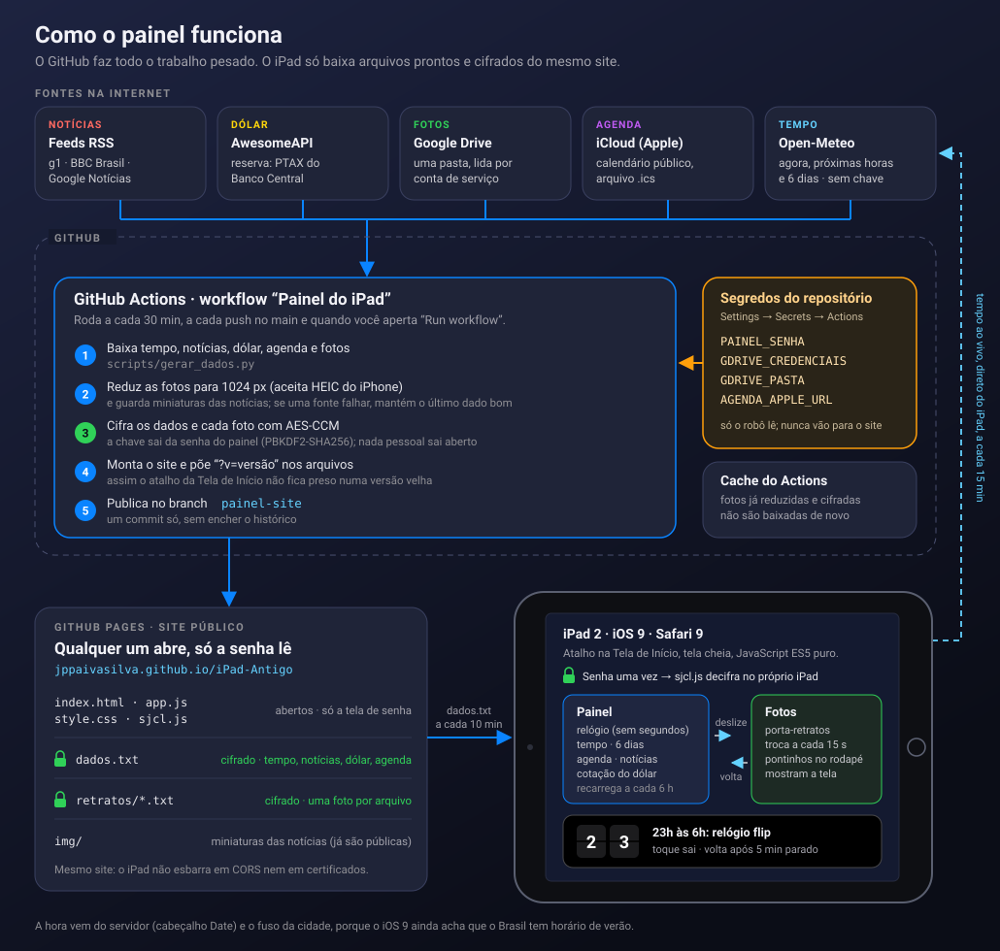

# iPad Antigo — painel de parede

Transforma um **iPad 2 (iOS 9, Safari 9)**, que já não roda quase nenhum app
nem site moderno, em um painel de parede sempre ligado com **relógio, tempo,
agenda da Apple, notícias, cotação do dólar e porta-retratos** com fotos do
Google Drive.

## A ideia

O iPad antigo é lento e o Safari dele não entende JavaScript moderno, não
conhece os certificados de segurança atuais e não consegue falar com a maioria
das APIs. Então ele não faz quase nada sozinho:

- **O GitHub faz o trabalho pesado.** A cada 30 minutos um robô do GitHub
  Actions busca tempo, notícias, dólar, agenda e fotos, prepara tudo e publica
  no GitHub Pages, de graça e sem servidor próprio.
- **O iPad só lê arquivos prontos do mesmo site.** Assim não esbarra em CORS
  nem em certificados que o iOS 9 não conhece. A página é estática, em
  JavaScript ES5 puro.
- **O site é público, mas o conteúdo é privado.** Agenda, fotos e o resto vão
  cifrados (AES-CCM). Sem a senha, quem abrir o endereço vê só a tela de login.



## O que aparece na tela

| Tela | O que mostra |
| --- | --- |
| **Painel** (principal) | Relógio sem segundos e data; tempo agora, próximas horas e 6 dias; cartão **Agenda** com os próximos compromissos; **Notícias** com miniatura quando há imagem; cotação do **dólar** ao lado do título das notícias. |
| **Fotos** | **Deslize o painel para a esquerda** e entra o porta-retratos, trocando a foto a cada 15 s. **Deslize para a direita** para voltar. Os pontinhos no rodapé mostram em qual tela você está. Para testar, abra o endereço com `#fotos` no fim. |
| **Relógio noturno** | Das **23h às 6h** a tela vira um relógio grande de cartões que viram a cada minuto (flip clock). **Toque** para voltar ao painel; à noite ele volta sozinho depois de 5 min sem tocar. De dia, um toque no painel abre o relógio e outro fecha. |
| **Senha** | Na primeira vez o iPad pede a senha e se lembra dela. |

**Relógio para o iPhone.** O mesmo relógio de cartões também existe sozinho em
[`relogio.html`](relogio.html), pensado para um iPhone 5S antigo (iOS 12):
https://jppaivasilva.github.io/iPad-Antigo/relogio.html. Não pede senha nem
busca dados, usa a hora do próprio aparelho e se ajusta em pé (horas em cima,
minutos embaixo) ou deitado (lado a lado). No Safari, *Compartilhar →
Adicionar à Tela de Início* para abrir em tela cheia, e em *Ajustes → Tela e
Brilho* deixe o Bloqueio Automático em "Nunca".

Detalhes que fazem diferença no iPad 2:

- **Hora certa mesmo com o iOS desatualizado.** O relógio usa a hora do
  servidor (cabeçalho `Date`) e o fuso da cidade, porque o iOS 9 ainda acha que
  o Brasil tem horário de verão.
- **Tempo ao vivo.** Além do `dados.txt`, o iPad tenta buscar o tempo direto no
  Open-Meteo a cada 15 min; se não conseguir, usa o que o robô deixou.
- **Sem acumular memória.** A página recarrega sozinha a cada 6 h.
- **Atalho sempre atualizado.** O atalho da Tela de Início costuma guardar
  `app.js` e `style.css` antigos. O robô põe `?v=<versão>` no endereço desses
  arquivos, então cada mudança publicada chega ao iPad.
- **Se uma fonte falhar**, o robô mantém o último dado bom em vez de apagar o
  cartão.

## Serviços usados

| Serviço | Para quê | Precisa de conta ou chave? |
| --- | --- | --- |
| [GitHub Actions](https://docs.github.com/actions) | Roda `scripts/gerar_dados.py` a cada 30 min, a cada push no `main` e quando você aperta **Run workflow**. | Não, já vem com o repositório. |
| [GitHub Pages](https://pages.github.com) | Hospeda o site que o iPad abre, a partir do branch `painel-site`. | Não. |
| [Open-Meteo](https://open-meteo.com) | Tempo: agora, próximas horas e 6 dias. | Não. |
| Feeds RSS: [g1](https://g1.globo.com), [BBC Brasil](https://www.bbc.com/portuguese), [Google Notícias](https://news.google.com) | Manchetes e miniaturas. Os feeds ficam em `config.json`. | Não. |
| [AwesomeAPI](https://docs.awesomeapi.com.br) e, de reserva, [PTAX do Banco Central](https://dadosabertos.bcb.gov.br) | Cotação do dólar. Se a AwesomeAPI recusar (limite de uso), vale a PTAX, que muda uma vez por dia. | Não. |
| [Google Drive](https://drive.google.com) + Google Cloud | Pasta com as fotos do porta-retratos, lida por uma **conta de serviço** só com permissão de leitura. | Sim: segredos `GDRIVE_CREDENCIAIS` e `GDRIVE_PASTA`. |
| [Calendário do iCloud](https://www.icloud.com/calendar) | Próximos compromissos de uma agenda da Apple, pelo link de **Calendário Público**. | Sim: segredo `AGENDA_APPLE_URL`. |
| [Let's Encrypt](https://letsencrypt.org) | Certificado do GitHub Pages. O iPad precisa da raiz ISRG Root X1 instalada (veja abaixo). | Não. |

## Como os arquivos se encaixam

| Arquivo | Papel |
| --- | --- |
| [`index.html`](index.html) | Estrutura das telas: painel, fotos, relógio noturno e senha. |
| [`app.js`](app.js) | Tudo que roda no iPad: relógio, troca de telas, leitura e decifragem de `dados.txt`. Ajustes da tela no objeto `CONFIG`, no topo. |
| [`style.css`](style.css) | Visual no estilo iOS, com cores de reserva para o Safari antigo. |
| [`relogio.html`](relogio.html) | Relógio de cartões sozinho, para o iPhone (estilo e script dentro do próprio arquivo). |
| [`sjcl.js`](sjcl.js) | Biblioteca de criptografia que funciona no Safari 9. |
| [`config.json`](config.json) | Cidade, coordenadas, fuso, feeds de notícias e limites (notícias, fotos, dias da agenda). |
| [`scripts/gerar_dados.py`](scripts/gerar_dados.py) | O robô: busca as fontes, reduz fotos, cifra e grava `dados.txt` e `retratos/`. |
| [`.github/workflows/painel.yml`](.github/workflows/painel.yml) | Agenda o robô, monta o site e publica no branch `painel-site`. |

O que vai para o site público:

| Publicado | Como |
| --- | --- |
| `index.html`, `app.js`, `style.css`, `sjcl.js` | Abertos. Sozinhos, só mostram a tela de senha. |
| `relogio.html` | Aberto. Só o relógio, sem dados. |
| `dados.txt` | **Cifrado.** Tempo, notícias, dólar e agenda. |
| `retratos/*.txt` | **Cifrados**, uma foto por arquivo, com nomes que não revelam nada. |
| `img/` | Miniaturas das notícias, abertas por já serem públicas. |

`data.json` (a versão aberta dos dados) é gerado só dentro do robô e **nunca é
publicado**.

### Como funciona a senha

A chave é tirada da senha com PBKDF2-SHA256 (20 000 iterações). O robô cifra
`dados.txt` e cada foto com AES-CCM usando essa chave; o iPad recebe a senha
uma vez, calcula a mesma chave com o `sjcl.js` e guarda só a chave no próprio
aparelho. A senha nunca fica no repositório nem no site.

## Configurar

Edite [`config.json`](config.json): cidade, latitude/longitude, fuso e os feeds
RSS. Latitude e longitude da sua cidade: procure em https://open-meteo.com/en/docs.

| Campo | Padrão | O que muda |
| --- | --- | --- |
| `max_noticias` | 18 | Quantas notícias entram no rodízio. |
| `max_fotos` | 300 | Quantas fotos da pasta (as mais recentes). |
| `dias_agenda` | 14 | Quantos dias à frente a agenda olha. |
| `max_eventos` | 8 | Quantos compromissos aparecem. |

Ajustes da tela (troca das notícias, horário do relógio noturno, troca das
fotos) ficam no topo de [`app.js`](app.js), no objeto `CONFIG`.

## Segredos (uma vez só, antes de publicar)

Tudo em **Settings → Secrets and variables → Actions → New repository secret**.
Os valores ficam só no GitHub: o robô os lê durante a execução e eles **nunca
vão para o site nem para o repositório**. Não cole esses valores em arquivos,
issues ou commits.

| Segredo | Obrigatório? | O que é | Se faltar |
| --- | --- | --- | --- |
| `PAINEL_SENHA` | **Sim** | A senha do painel. | O robô para e não publica nada. |
| `GDRIVE_CREDENCIAIS` | Para as fotos | O JSON inteiro da chave da conta de serviço do Google. | Publica sem fotos. |
| `GDRIVE_PASTA` | Para as fotos | O código da pasta do Drive. | Publica sem fotos. |
| `AGENDA_APPLE_URL` | Para a agenda | O link `webcal://` do Calendário Público do iCloud. | O cartão Agenda some. |

### 1. `PAINEL_SENHA`

Use uma frase longa (por exemplo, quatro palavras aleatórias). Trocar a senha
faz o iPad pedir a nova.

### 2. `GDRIVE_CREDENCIAIS` (conta de serviço do Google)

É ela que lê a pasta, só com permissão de leitura.

1. Em https://console.cloud.google.com crie um projeto (ex.: "painel-ipad").
2. **APIs e serviços → Biblioteca → Google Drive API → Ativar**.
3. **IAM e administrador → Contas de serviço → Criar**; dê um nome e conclua
   sem papéis.
4. Na conta criada: **Chaves → Adicionar chave → JSON**. Baixa um arquivo.
5. Crie o segredo **`GDRIVE_CREDENCIAIS`** colando o conteúdo inteiro desse
   arquivo. Depois apague o arquivo do computador.

### 3. `GDRIVE_PASTA` (pasta das fotos)

No Google Drive, compartilhe a pasta com o e-mail da conta de serviço (termina
em `iam.gserviceaccount.com`) como **Leitor**. Crie o segredo
**`GDRIVE_PASTA`** com o código da pasta: o trecho depois de `/folders/` no
endereço dela.

Fotos novas na pasta aparecem no painel em até 30 min. Fotos do iPhone (HEIC)
funcionam. Fotos já preparadas ficam no cache do Actions e não são baixadas de
novo.

### 4. `AGENDA_APPLE_URL` (agenda da Apple)

No iPhone, app **Calendário → Calendários → ⓘ** da agenda → ligue
**Calendário Público** → **Compartilhar Link… → Copiar**. Crie o segredo
**`AGENDA_APPLE_URL`** colando esse link (começa com `webcal://`). Quem tiver o
link consegue ver a agenda, por isso ele fica só no segredo. Compromissos que
se repetem são expandidos e os horários saem no fuso da cidade.

> **Dica:** se algo não aparecer, abra o log do passo **"Baixar tempo,
> notícias, fotos e agenda"** no Actions. Ele diz, por exemplo, "Fotos: …
> não configurados" ou "Agenda: AGENDA_APPLE_URL não configurado".

## Publicar (uma vez só)

1. Em **Actions**, rode o workflow **Painel do iPad** (ou espere o próximo ciclo).
   Ele cria o branch `painel-site`.
2. Em **Settings → Pages**, escolha *Deploy from a branch* → `painel-site` / `(root)`.
3. O painel fica em https://jppaivasilva.github.io/iPad-Antigo/

Depois disso não há nada a fazer: o robô republica sozinho a cada 30 min.

## Preparar o iPad

**Certificado (obrigatório no iOS 9).** O GitHub Pages usa certificados da
Let's Encrypt, cuja raiz (ISRG Root X1) o iOS 9 não conhece. Instale-a uma vez:
no **Safari** do iPad abra `http://x1.i.lencr.org/` (link oficial da Let's
Encrypt, sem o "s") → **Instalar** → digite o código → **Instalar** → **OK**.
Impressão digital SHA-256: `96:BC:EC:06:…:BD:DF:08:C6`.

0. Libere espaço (**Ajustes → Geral → Uso**): com 0 bytes livres o Safari
   pode fechar sozinho ou não salvar o ícone.
1. Abra o endereço no Safari e toque em **Compartilhar → Adicionar à Tela de Início**.
   Abrindo pelo ícone, a página ocupa a tela inteira, sem barra do Safari.
   Abra pelo ícone e digite a senha ali (o ícone guarda a senha separado do
   Safari). A primeira entrada leva alguns segundos no iPad 2.
2. **Ajustes → Geral → Bloqueio Automático → Nunca** (a tela não apaga).
3. Opcional: **Ajustes → Geral → Acessibilidade → Acesso Guiado** para travar o
   iPad só no painel (três cliques no botão Início para ativar).
4. Deixe na tomada e, se puder, abaixe o brilho.

## Testar no computador

```sh
PAINEL_SENHA=teste python3 scripts/gerar_dados.py   # gera dados.txt (fotos só com os segredos do Drive)
python3 -m http.server 8000      # abra http://localhost:8000
```
